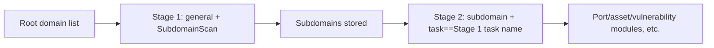

---

## name: scopesentry-mcp
description: Manage the security-scanning platform (projects, tasks, templates, assets, nodes) through the ScopeSentry MCP. Use it when the user mentions ScopeSentry, MCP, API Key, scan tasks, or asset queries.

# ScopeSentry MCP user guide

For users with a **deployed ScopeSentry instance**. Connect to the platform through Cursor (or another MCP client); no local source code is needed.

## 1. Preparation

### 1.1 Confirm the service is reachable

- Default Web UI: `http://<host>`
- MCP endpoint: `http://<host>/mcp` (if there is a reverse proxy or front-end proxy in front, use the actual `/mcp` address)

### 1.2 Create an API Key

1. Log in to the ScopeSentry Web UI in a browser
2. Go to the **API Key** management page and create a key (or create one via an interface provided by the administrator)
3. Save the returned `ssk_...` string (**shown only once**)

### 1.3 Configure Cursor MCP

Cursor → Settings → MCP → add a server:

```json
{
  "mcpServers": {
    "scopesentry": {
      "url": "http://<your-host>:8082/mcp",
      "headers": {
        "X-API-Key": "ssk_your-key"
      }
    }
  }
}
```

You can also use: `Authorization: Bearer ssk_your-key`

After configuring, restart the MCP or reload Cursor, and confirm that `list_projects`, `list_assets`, etc. appear in the tool list.

---

## 2. Tool overview


| Tool                     | Purpose                |
| ---------------------- | ----------------- |
| `list_projects`        | Project tree grouped by tag (includes project ID) |
| `list_projects_data`   | Paginated project list, searchable by name     |
| `get_project`          | Project detail              |
| `create_project`       | Create a project              |
| `list_tasks`           | Scan task list            |
| `get_task`             | Task detail              |
| `list_scan_templates`  | Scan template list            |
| `get_scan_template`    | Template detail              |
| `list_plugin_modules`  | Scan-pipeline module names          |
| `list_plugins`         | Available plugins (includes hash, default parameters) |
| `create_scan_template` | Create a scan template            |
| `create_scan_task`     | Create a scan task            |
| `list_assets`          | Query various assets (paginated list)       |
| `count_assets`         | Count assets (`/api/assets/common/total`) |
| `get_asset_detail`     | Asset or vulnerability detail           |
| `add_asset_tag`        | Add a tag to an asset           |
| `list_nodes`           | Scan node list            |


Each tool's parameters follow the MCP tool description (schema); the `search` / `filter` syntax of `list_assets` / `count_assets` is identical, and you may read the `list_assets` description before querying assets.

When you need to know "how many in total", use `count_assets` (corresponding to the Web pagination-total interface) instead of repeatedly paging `list_assets` just to count the total.

---

## 3. Common workflows

### 3.1 Query assets by project

When the user or context **already has a project condition**, prefer adding `filter.project` to narrow the range and avoid slow responses from too much cross-project data. If there is no clear project, you do not have to force a project filter.

1. `list_projects` or `list_projects_data` to get the target project's **ObjectID** (`id` / `children[].value`)
2. `list_assets` with `filter.project` (**must be the ID, not the project's display name**)

```json
{
  "asset_type": "asset",
  "pageIndex": 1,
  "pageSize": 20,
  "search": "domain=^example.com",
  "filter": {
    "project": ["<project ObjectID>"]
  }
}
```

### 3.2 Create a scan task

1. `list_nodes` to get online node names
2. `list_scan_templates` or `create_scan_template` to get the template **ObjectID**
3. `create_scan_task`: `name` and `node` are required; `template` takes the template ID (not the template name)

**Target source `targetSource` (same as the Web side):**

| targetSource | Meaning | Required parameters |
| --- | --- | --- |
| `general` | Enter the target directly | `target` |
| `project` | Read targets from a project | `project` (array of project ObjectIDs) |
| `asset` | Search from the Web asset store | `search`; optional `project`, `filter`, `targetNumber` |
| `RootDomain` | Search from the root-domain store | `search`; optional `project`, `filter`, `targetNumber` |
| `subdomain` | Search from the subdomain store | `search`; optional `project`, `filter`, `targetNumber` |
| `UrlScan` | Search from URL-scan results | `search`; optional `project`, `filter`, `targetNumber` |
| `*Source` (e.g. `subdomainSource`) | Create from "selected/searched" on the asset page | with `targetTp=search` use `search`; with `targetTp=select` use `targetIds` |

**Example — scan a root domain directly:**

```json
{
  "name": "example-subdomain-collection",
  "node": ["node-1"],
  "template": "<template ObjectID>",
  "targetSource": "general",
  "target": "example.com\nfoo.com",
  "project": ["<project ObjectID>"]
}
```

**Example — continue scanning from the subdomain store (filter by the previous task name):**

```json
{
  "name": "example-ports-and-vulns",
  "node": ["node-1"],
  "template": "<follow-up-modules template ObjectID>",
  "targetSource": "subdomain",
  "search": "task==\"example-subdomain-collection\"",
  "project": ["<project ObjectID>"]
}
```

### 3.3 Full information gathering for a root domain (two-stage recommended)

When the input is a **root domain** and you want **full information gathering**, it is recommended to scan in two passes rather than running the whole pipeline at once.

**Reason:** distributed tasks are dispatched per **single target**. When a root domain is the target, after a node is assigned that root domain, the subdomains it discovers on that node also continue running the follow-up modules on that same node, which easily causes load imbalance, slowness, and errors.

**Best practice:**

1. **Stage 1 — subdomain collection only**
   - `targetSource`: `general`
   - `target`: all root domains (multiple lines)
   - Template: enable only `SubdomainScan`, `SubdomainSecurity` (subdomain scan + subdomain takeover)
   - Use `get_task` to wait for the task to complete

2. **Stage 2 — follow-up modules**
   - `targetSource`: `subdomain`
   - `search`: `task=="<Stage 1 task name>"` (exact match on the task name)
   - Optional `project` to narrow the range
   - Template: port scan, asset mapping, vulnerability scan, etc. (may exclude SubdomainScan)
   - Subdomains are dispatched as independent targets to each node, for higher parallel efficiency

Alternatively, on the Web "Subdomain" asset page, filter by task name and then use "create task from subdomains" — the effect is the same.



### 3.4 Create a scan template

1. `list_plugin_modules` → list of module names
2. `list_plugins` (can filter by `module`) → each plugin's `hash` and default `parameter`
3. `create_scan_template`: use `modules` to specify "module → array of plugin hashes"

---

## 4. Asset queries (`list_assets` / `count_assets`)

`count_assets` uses the same `asset_type`, `search`, and `filter` as `list_assets`, and returns `{ "total": N }`, corresponding to the Web side's `/api/assets/common/total`.

```json
{
  "asset_type": "subdomain",
  "search": "task==\"some-task-name\"",
  "filter": {"project": ["<project ObjectID>"]}
}
```

**Performance tips (apply to both `list_assets` / `count_assets`):** when there is a project condition, prefer `filter.project` to narrow the range; in `search`, for indexed fields prefer `==` exact match or `^` prefix match (see [4.3](#43-search-expressions)) to avoid broad `=` fuzzy queries slowing the response. When there is no project context, do not force a project filter.

See the table in [4.4](#44-filter-exact-filtering) for the types that support `filter.project`.

### 4.1 Asset types (`asset_type`)

`asset`, `RootDomain`, `subdomain`, `app`, `mp`, `UrlScan`, `SensitiveResult`, `DirScanResult`, `crawler`, `vulnerability`, `PageMonitoring`, `IPAsset`, `SubdomainTakerResult`

Alias examples: `web`→asset, `vuln`→vulnerability, `ip`→IPAsset, `url`→UrlScan

### 4.2 Parameters


| Parameter                       | Meaning                                      |
| ------------------------ | --------------------------------------- |
| `pageIndex` / `pageSize` | Pagination, default 1 / 20                            |
| `search`                 | Search expression (see next section)                              |
| `filter`                 | Exact-filter JSON (see next section)                          |
| `sort`                   | Only UrlScan, DirScanResult support sorting by `length` |
| `sid`                    | SensitiveResult only: the sensitive-rule name                |


`search` and `filter` **can be used together**.

### 4.3 search expressions

A custom DSL (**not SQL**):


| Operator  | Meaning   | Index | Example                          |
| ---- | ---- | ---- | --------------------------- |
| `=`  | Fuzzy match (regex) | no index | `domain=example`            |
| `==` | Exact match | **uses index** | `port==443`                 |
| `!=` | Exclude   | — | `port!="80"`                |
| `&&` | AND    | — | `domain==example.com && port==443` |
| `||` | OR    | — | `title=admin || body=login` |


**Indexes and operators:** fields like `domain`, `ip`, `port`, `title` are indexed, but only **`==` exact match** or a **prefix match whose value starts with `^`** (e.g. `domain=^example.com`) can use the index; **`=` is converted to a regex fuzzy match and cannot use the index**, which easily gets slow with large data volumes.

**search fields common to all types:** `tag`, `task` (task name), `rootDomain`

**`project` cannot be written in `search`** (it is ineffective, or errors when combined with `&&`). To filter by project, use `filter.project`.

**Common search fields per type:**


| asset_type           | Fields                                                                                  |
| -------------------- | ----------------------------------------------------------------------------------- |
| asset                | domain, ip, port, service, app, title, statuscode, icon, banner, type, body, header |
| RootDomain           | domain, icp, company                                                                |
| subdomain            | domain, ip, type, value                                                             |
| app                  | name, icp, company, category, description, url, apk                                 |
| mp                   | name, icp, company, category, description, url                                      |
| UrlScan              | url, input, source, resultId, type                                                  |
| SensitiveResult      | url, sname, body, info, md5                                                         |
| DirScanResult        | url, statuscode, redirect, length                                                   |
| vulnerability        | url, vulname, matched, request, response, level                                     |
| crawler              | url, method, body, resultId                                                         |
| PageMonitoring       | url, hash, diff, response                                                           |
| IPAsset              | ip, domain, port, service, webServer, app                                           |
| SubdomainTakerResult | domain, value, type, response                                                       |


**search examples:**

- `domain==www.example.com && port==443` (exact match, uses index)
- `domain=^example.com` (prefix match, uses index)
- `ip==192.168.1.1`
- `task=="some-task-name"`
- `level==high` (vulnerability)
- `statuscode==200` (DirScanResult)

When you need a fuzzy contains, use `=`, e.g. `title=admin` (does not use the index; best combined with a project or other condition to narrow the range).

### 4.4 filter (exact filtering)

A JSON object: multiple values for the same key are **OR**, different keys are **AND**.

**Prefer `project` when there is a project condition:** if the user or context has a clear project and the asset_type supports `project`, include it to narrow the range; do not force it when there is no project info.


| filter key   | Meaning       | Value notes                                                     |
| ------------ | -------- | -------------------------------------------------------- |
| `project`    | Owning project     | **ObjectID**, obtained via `list_projects` / `list_projects_data` |
| `task`       | Source task     | **Task name**, from the `name` of `list_tasks`                         |
| `port`       | Port       | e.g. `"443"`                                                |
| `service`    | Service/protocol    | e.g. `"https"`                                              |
| `app`        | App fingerprint     | e.g. `"Nginx"`                                              |
| `icon`       | Icon hash  |                                                          |
| `statuscode` | HTTP status code | mainly for asset                                               |
| `status`     | Status       | UrlScan/DirScan HTTP code; vulnerability/sensitive-info handling status                       |
| `level`      | Vulnerability level     | critical / high / medium / low / info                    |
| `type`       | Type       | e.g. subdomain record type A, CNAME                                         |
| `color`      | Sensitive-rule color   | SensitiveResult                                          |
| `sname`      | Sensitive-rule name    | SensitiveResult                                          |
| `tags`       | Tags       |                                                          |


**filter keys available per type:**


| asset_type                            | filter key                                                      |
| ------------------------------------- | --------------------------------------------------------------- |
| asset                                 | project, port, service, app, icon, statuscode, type, task, tags |
| RootDomain                            | project, tags                                                   |
| subdomain                             | project, type, task, tags                                       |
| app / mp                              | project, tags                                                   |
| UrlScan                               | status, tags                                                    |
| DirScanResult                         | status, tags                                                    |
| SensitiveResult                       | status, color, sname, tags                                      |
| crawler                               | project, task, tags                                             |
| vulnerability                         | project, level, status, task, tags                              |
| PageMonitoring / SubdomainTakerResult | tags                                                            |
| IPAsset                               | project, port, service, app                                     |


**filter example:**

```json
{"project": ["<project ObjectID>"], "port": ["443"]}
```

**Combined-query example:**

```json
{
  "asset_type": "asset",
  "search": "domain=^baidu && port==443",
  "filter": {"project": ["<project ObjectID>"]},
  "pageIndex": 1,
  "pageSize": 10
}
```

**Notes:**

- When there is a project condition, prefer `filter.project` (when supported); you do not have to force it with no project context
- Do not put a project display name in `filter.project`
- Use `==` for known values and `^` for prefixes; avoid abusing `=` fuzzy match on large tables
- For UrlScan HTTP status use `filter.status`; for DirScanResult you can use `statuscode==200` in `search`
- For SensitiveResult by rule name: use `sname=rule-name` in `search`, or `filter.sname`

### 4.5 Sorting (sort)

Only **UrlScan** and **DirScanResult** support it:

```json
{"length": "ascending"}
```

Other types ignore `sort` and sort by time by default.

---

## 5. Scan template module names

`TargetHandler`, `SubdomainScan`, `SubdomainSecurity`, `PortScanPreparation`, `PortScan`, `PortFingerprint`, `AssetMapping`, `AssetHandle`, `URLScan`, `WebCrawler`, `URLSecurity`, `DirScan`, `VulnerabilityScan`, `PassiveScan`

---

## 6. Troubleshooting


| Symptom        | Handling                                                 |
| --------- | -------------------------------------------------- |
| MCP has no tools   | Check the URL, API Key, and whether ScopeSentry is running                    |
| 401 / 403 | Recreate or replace the API Key                                    |
| Assets not found     | Confirm `filter.project` is an ObjectID; do not write project in search |
| Template/task creation fails | `template` must be a template ObjectID; `node` takes an online node name            |
| Very slow / stuck   | With a project, add `filter.project`; in search switch indexed fields to `==` or `^` prefix and use `=` less; reduce `pageSize` |


---
